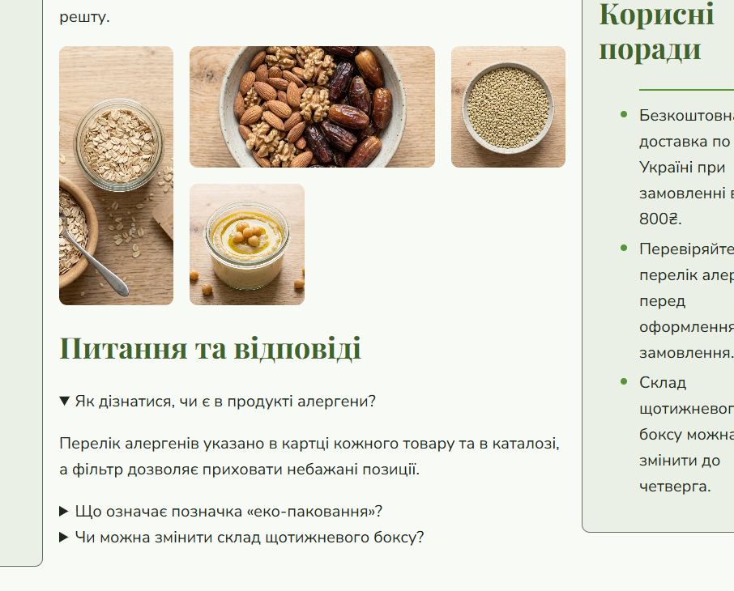
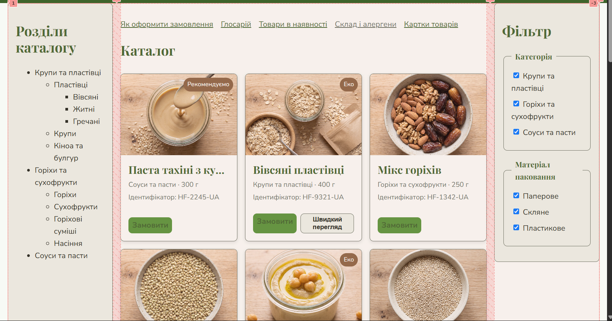
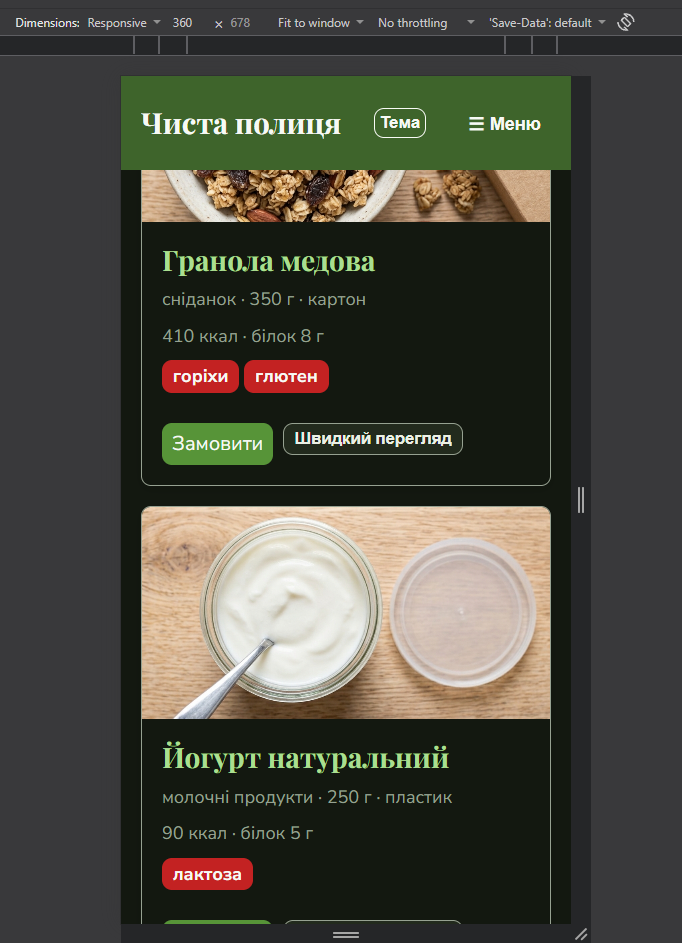
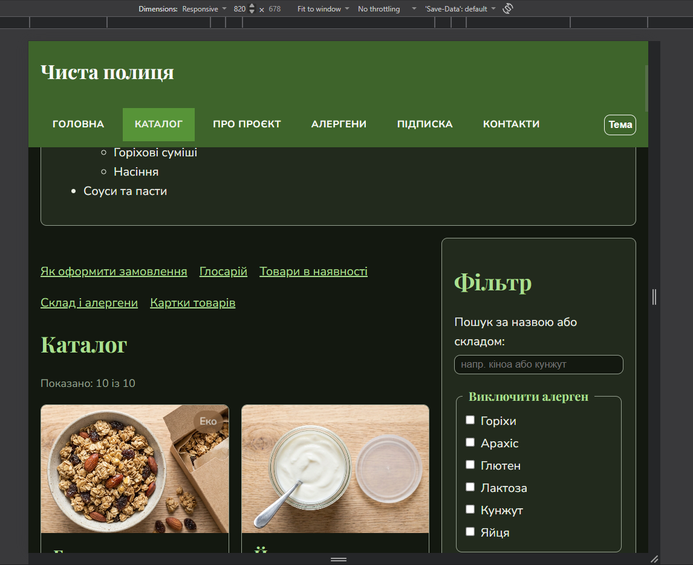
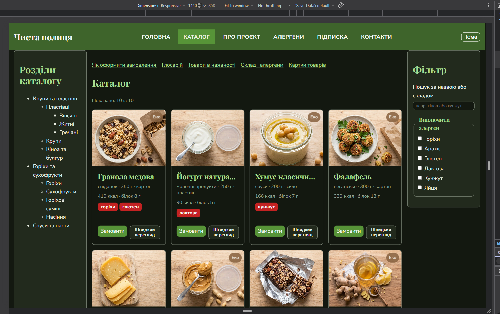
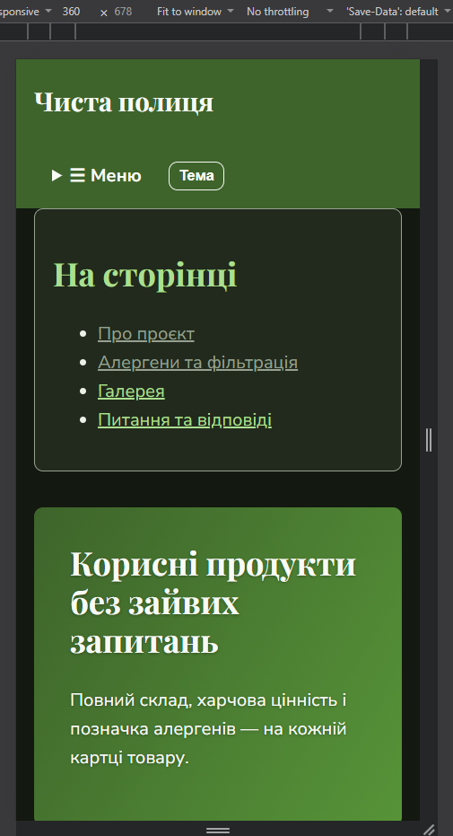
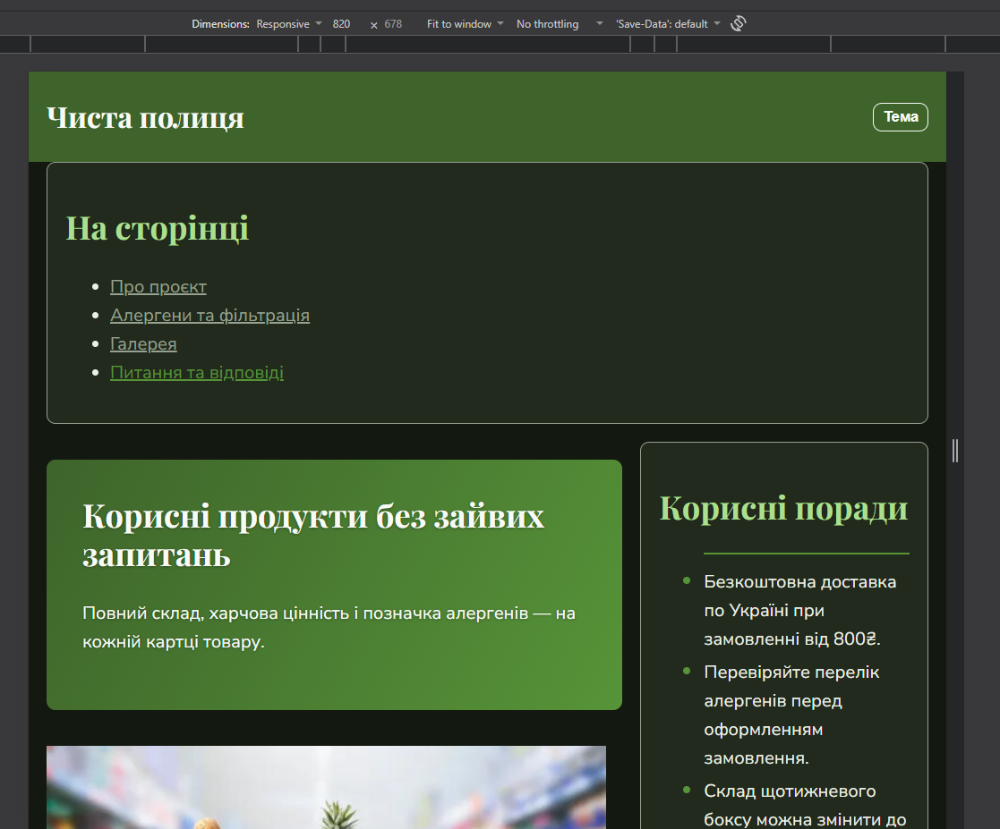
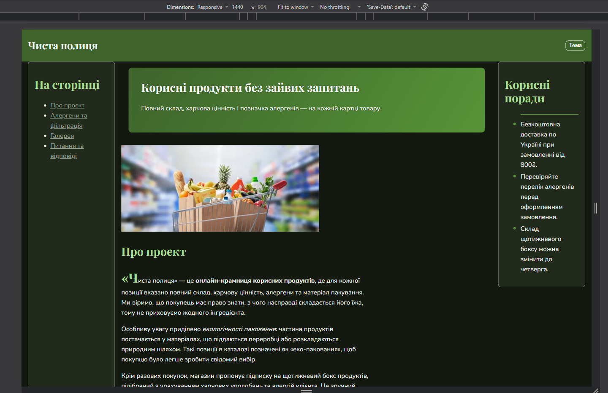
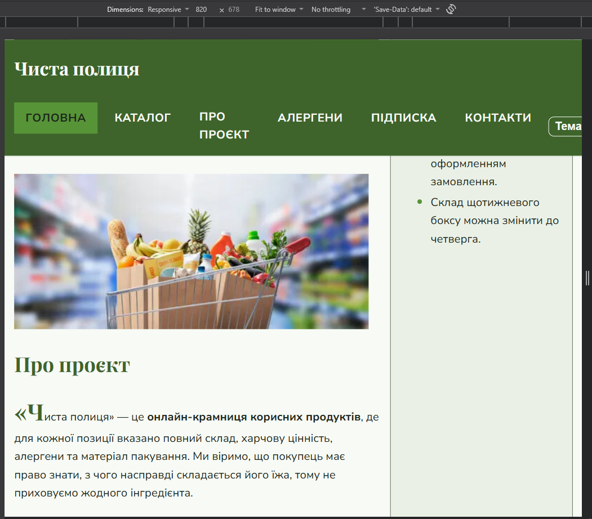

# Чиста полиця

«Чиста полиця» — онлайн-крамниця корисних продуктів: для кожного товару
вказано склад, харчову цінність, алергени та екологічність паковання.
Сайт пропонує підписку на щотижневий бокс продуктів.

**Варіант:** 9 — «Продукти здорового харчування»

**Автор:** Полажинець Михайло

## Опис предметної області

Розділи меню сайту: Головна, Каталог, Про проєкт, Алергени, Підписка,
Контакти.

Дані про продукти зберігаються у `variants-data/variant09.json` — масив
із 10 продуктів. У кожного є:

- `name`, `category`;
- `ingredients` — масив рядків (склад);
- `nutrition` — вкладений об'єкт: `cal`, `fat_g`, `carbs_g`, `protein_g`;
- `allergens` — масив алергенів;
- `package` — вкладений об'єкт: `weight_g`, `material`, `eco`.

Особливості:

- `eco` — булеве значення, але на сторінці показується не як
  `true`/`false`, а як позначка «еко-паковання»;
- `allergens` використовується для фільтра «виключити» (off), а не
  «показати тільки» (on);
- предметний ідентифікатор — код продукту формату `HF-0782-UA`.

---

# LR1 — перша сторінка і робота з Git

Створено репозиторій і головну сторінку `index.html` з повним скелетом
документа: `<!DOCTYPE html>`, `<html lang="uk">`, `<meta charset>`,
`<meta name="viewport">`, `<title>` і фавікон.

На сторінці:

- заголовок `<h1 id="top">` і навігація «Зміст» з якірними посиланнями
  на розділи «Про проєкт» (`#store`) та «Алергени та фільтрація»
  (`#alergic`);
- кілька абзаців з виділенням `<strong>` і `<em>`, цитата
  `<blockquote>`;
- зображення полиці з продуктами з `alt`, `width` і `height`;
- зовнішнє посилання на сайт ВООЗ з `target="_blank"` і
  `rel="noopener noreferrer"`, внутрішнє посилання на `about.html`;
- посилання «Нагору» після кожного розділу, `
` і підпис автора.

Додано сторінку `about.html` («Про магазин»).

## Запити в браузері (DevTools → Network)

Під час оновлення сторінки браузер робить 6 запитів:

1. `index.html` - сам документ;
2. `favicon.jpg` - іконка вкладки;
3. `healthy-shelf.jpg` - зображення на сторінці;
4. `content.css`;
5. `sprite.svg`;
6. `ws` - WebSocket-з'єднання.

Перші п'ять — це сама сторінка і файли, на які вона посилається: кожен
ресурс браузер завантажує окремим HTTP-запитом. `ws` відкриває Live
Server: через це з'єднання він повідомляє браузер про зміни у файлі, і
сторінка оновлюється автоматично.

# LR2 - семантична розмітка каталогу

`index.html` перебудовано на семантичний каркас без жодного `
`:
`header` з `<h1>` і `<nav aria-label="Головне меню">`, один `<main>`,
дві `<section>` («Про проєкт» і «Алергени та фільтрація»), два
`<article>` карток товарів (кожен зі своїм `header`, `footer` і
`<time datetime="...">`), `<aside>` з порадами, `<footer>` з
`<address>`.

Додано `catalog.html` — сторінку каталогу з тим самим каркасом:

- вкладений `<ul>` розділів каталогу;
- два `<ol>` кроків оформлення замовлення (другий продовжує
  нумерацію через `start`);
- `<dl>`-глосарій предметної області;
- таблиця товарів з `caption`, `thead`/`tbody`, `scope="col"`/`scope="row"`,
  `colspan` і `rowspan`.

На обох сторінках є блоки `
`/`
` («Питання та
відповіді») і зображення з `alt`/`width`/`height`: перше без
`loading="lazy"`, бо воно у видимій зоні, решта — з `lazy`. Одне
зображення оформлено як `<figure>` з `<figcaption>`.

## Бонусні завдання LR2

- **`<picture>` з двома джерелами** — головне зображення на
  `index.html` вставлено через `<picture>` з `<source type="image/webp">`
  і `<source type="image/jpeg">`.
- **`<tfoot>` з підсумком** — у таблиці каталогу є підсумковий рядок
  («Разом (10 позицій), сумарна вага пакувань») з `colspan` на підпис.
- **Третя сторінка** — `about.html` («Контакти») з тим самим
  каркасом, додана в меню всіх сторінок; у футерах — `<address>`.
- **Друга навігація** — на `catalog.html` є другий
  `<nav aria-label="Навігація по сторінці">` із якірними посиланнями
  на всі секції сторінки.

---

# LR3 - форма підписки на щотижневий бокс

## Сторінка form.html

Додано сторінку `form.html` («Підписка на щотижневий бокс — Чиста
полиця») з тим самим семантичним каркасом: `header`, `nav`, `main`,
`footer`. Посилання «Підписка» додано в головне меню всіх чотирьох
сторінок, тому навігація наскрізна в обидва боки.

## Метод відправлення

Форма відправляється на `/submit` методом `post`. Форма створює нову
підписку, тому повторне надсилання після F5 не повинно відбуватися
випадково. До того ж персональні дані (ім'я, пошта, телефон) не повинні
потрапляти в URL, історію браузера чи логи сервера.

## Структура форми

| Група (`fieldset`) | Поля |
|---|---|
| Дані користувача | прізвище та ім'я (`text`), пошта (`email`), телефон (`tel`), дата першої доставки (`date`), адреса доставки (`text`) |
| Параметри боксу | тип боксу (`select`, 4 варіанти + підказка з порожнім `value`), кількість осіб (`number`), періодичність боксу: щотижня/раз на два тижні/щомісяця (3 `radio`, «щотижня» вибрано за замовчуванням), виключити алергени: горіхи, глютен, лактоза (3 `checkbox`), код стартового продукту (`text`) |
| Додатково | побажання до складу (`textarea`), згода з умовами (`checkbox`) |

Кожне поле має `name` латиницею і пов'язаний `<label>` через `for`/`id`.
Усі `id` унікальні. У `placeholder` вказано приклад формату
(`+380671234567`, `HF-0782-UA`), а не назву поля. Кнопки:
`type="submit"` («Оформити підписку») і `type="reset"` («Очистити
форму»).

## Валідація HTML5

| Обмеження | Де використано |
|---|---|
| `required` | ім'я, пошта, телефон, дата, адреса доставки, тип боксу, кількість осіб, код стартового продукту, згода (9 полів) |
| `minlength` / `maxlength` | ім'я: 2–60 символів; побажання: 10–500 символів |
| `min` / `max` / `step` | кількість осіб: 1–5, крок 1; дата: з 01.09.2026 по 30.06.2027 (навчальний рік) |
| `pattern` + `title` | телефон `\+380[0-9]{9}`, код продукту `HF-[0-9]{4}-UA` |
| `autocomplete` | `name`, `email`, `tel` |

Над кожним `pattern` у коді є коментар з розбором регулярного виразу.

## Перевірка

- Порожню форму браузер не відправляє: фокус переходить у перше
  обов'язкове поле і з'являється підказка.
- Для неправильного телефону чи коду продукту в повідомленні видно
  текст з `title`.
- Якщо ввести кількість осіб більше за 5, форма не відправляється.
- Правильно заповнена форма проходить валідацію, і браузер відправляє
  запит на `/submit`. Live Server відповідає помилкою **405 Method Not
  Allowed**: він лише віддає статичні файли і не приймає POST-запити.
  Обробника немає, тому так і має бути.
- У консолі є лише повідомлення Live Server про закрите WebSocket-з'єднання
  (сторінка потрапила в Back-Forward Cache після переходу на `/submit`).
  Це не помилка сторінки.
- Пошук `input:not([name])`, `textarea:not([name])`,
  `select:not([name])` у панелі Elements нічого не знаходить.
- `document.forms[0].checkValidity()` повертає `false` на порожній формі
  і `true` на заповненій, а `document.querySelectorAll("[required]").length`
  дорівнює 9.

## Перевірка валідатором W3C

| Сторінка | Errors до | Errors після | Що виправлено |
|---|---|---|---|
| index.html | 0 | 0 | — |
| catalog.html | 0 | 0 | — |
| about.html | 0 | 0 | — |
| form.html | 0 | 0 | — |

Попереджень (Warning) валідатор теж не показав на жодній сторінці.

## Чому клієнтської валідації недостатньо

У панелі Elements я видалив атрибут `required` у поля і відправив форму
порожньою — браузер її пропустив. Після F5 атрибут повернувся, бо
змінилася лише копія сторінки в моєму браузері. Отже, будь-хто може
обійти перевірки в HTML або взагалі відправити запит без форми, тому
дані з клієнта не можна вважати перевіреними. Клієнтська валідація —
лише зручна підказка для користувача, а справжню перевірку зобов'язаний
виконувати сервер.

---

# LR4 - Оформлення зовнішнього вигляду (CSS)

Додано `css/styles.css` і підключено його через `<link>` до всіх
сторінок. Уся стилізація живе в одному файлі: жодних блоків `<style>` чи атрибутів
`style` у розмітці немає (крім закоментованого демонстраційного рядка в
блоці про специфічність).

## Оформлення

**Шрифти** (обидва з підтримкою кирилиці, підключені через `@import` у
styles.css):

- заголовки — [Playfair Display](https://fonts.google.com/specimen/Playfair+Display), накреслення 700;
- основний текст — [Nunito Sans](https://fonts.google.com/specimen/Nunito+Sans), накреслення 400 і 700.

**Палітра** — «еко»: світлий фон, трав'янисто-зелений (брендовий і
акцентний), окремий коричневий для позначки еко-паковання і окремий
червоний для попередження про алергени.

**Змінні палітри** (`:root` у styles.css):

| Змінна | Призначення |
|---|---|
| `--color-brand` | трав'яний зелений (темніший) — шапка меню, заголовки, акцент легенди форми |
| `--color-accent` | трав'яний зелений (світліший) — кнопка «Оформити підписку», hover меню, зірочка обов'язкових полів |
| `--color-bg` | фон сторінки (світлий) |
| `--color-surface` | фон карток/таблиці (зебра), підказки `:focus:valid`/`:focus:invalid` |
| `--color-text` | основний колір тексту |
| `--color-muted` | другорядний текст, рамки полів і таблиці |
| `--color-hover` | підсвітка рядка таблиці під курсором |
| `--color-craft` | коричневий — мітка `.badge-eco` («еко-паковання») |
| `--color-allergen` | червоний — мітка `.badge-allergen` (попередження про алерген) |
| `--font-heading`, `--font-body` | шрифтові стеки з fallback |
| `--radius`, `--space-xs`, `--space-sm`, `--space-md`, `--space-lg`, `--measure`, `--shadow`, `--card-width`, `--card-img-h` | відступи, радіус, ширина абзацу, тінь (з запасним значенням), розміри карток (LR5) |

Найбільше часу пішло на вирівнювання колонок у таблиці каталогу: `rowspan` у
комірки «Категорія» зсуває позицію решти клітинок у різних рядках, тому
звичайний `td:nth-child()` ловив у різних рядках різні колонки. Рішення —
рахувати з кінця рядка: `td:nth-last-child(-n + 2)` завжди влучає саме в
Калорійність/Вагу, бо `rowspan` з'їдає клітинки з початку рядка, а не з
кінця. Другим за складністю був `:has()` для зірочки обов'язкових полів —
потрібно було покрити і випадок, коли `<label>` стоїть до `<input>`, і
випадок, коли після, одним правилом `p:has(> input:required) label::after`.

## Бонус: темна тема

У styles.css додано `body.dark-theme` - другий набір тих самих п'яти
змінних, тільки з іншими значеннями світлості; `--color-brand` і `--color-accent` лишилися без змін, бо на
темному тлі вони й так відносно контрастні. Решту правил в
файлі дублювати не довелося - уся стилізація сайту звертається до
кольорів лише через `var(...)`, тому підміна п'яти змінних під класом
перефарбовує весь сайт. Перевірено вручну додаванням
`class="dark-theme"` до `<body>` та зазначено коментом.

---

# LR5 — картки каталогу, блокова модель і позиціонування

На початку `styles.css` додано глобальний `*, *::before, *::after { box-sizing: border-box; }`
з поясненням різниці content-box/border-box. У `:root` до палітри LR4
додано розмірні змінні: `--space-xs/sm/md/lg`, `--card-width`,
`--card-img-h` (раніше була `--space` потім перейменував на `--space-md`, щоб
збігалась із рештою шкали).

У `catalog.html` з'явився розділ «Каталог» (`.cards`) із чотирма
картками товарів (`.card`/`.card__img`/`.card__body`/`.card__title`/
`.card__meta`/`.card__id`): фото, назва, категорія й вага паковання,
ідентифікатор формату `HF-0000-UA`. Бейдж «Еко» в кутку (`.card__badge`,
`position: absolute`) показано тільки у двох карток із чотирьох — тих,
де `eco: true` — паперове й скляне пакування: «Вівсяні пластівці» і
«Хумус класичний». «Гречка зелена...» і «Хумус класичний...» мають
свідомо довгу назву — для перевірки трьох крапок.

Шапка сайту (`body > header`) стала липкою (`position: sticky; top: 0;
z-index: 10`) з непрозорим фоном на всіх сторінках — селектор звужено
до прямого нащадка `body`, бо такий самий тег `header` використано і
всередині карток товарів на `index.html` (розмітка з LR2), і без
звуження правило перефарбувало б і їх. На `index.html` додано
градієнтний банер (`.banner`, `linear-gradient` на `--color-brand` →
`--color-accent`) одразу на початку `<main>`.

## object-fit

Експеримент на `.card__img`. Фото каталогу (у §9 замінені на набір
variant09) усі квадратні — 1024×1024, а рамка картки горизонтальна,
`100% × 170px`. На такому співвідношенні різниця між режимами добре видно:

- **`fill`** — зображення розтягується під задану рамку `100% × 170px`
  без збереження пропорцій: квадратне фото стає сплюснутим по висоті.
- **`contain`** — пропорції зберігаються, але зображення вписується
  цілком, і там, де воно не дотягує до рамки, з'являються порожні поля,
  фон картки просвічує зверху й знизу/з боків.
- **`cover`** — пропорції теж зберігаються, рамка заповнюється повністю,
  але частина зображення, що не влазить у рамку, обрізається (у квадратного
  кадру — зверху й знизу). Саме `cover` і лишено в `.card__img`.

Повністю вертикального (портретного) фото в наборі поки немає — на ньому
`cover` обрізав би боки, і ефект був би ще помітніший. Це єдиний кадр, який
лишилось додати окремо, щоб закрити пункт.

## Три крапки

Перевірено по черзі на картках зі свідомо довгою назвою:

- без `white-space: nowrap` — довга назва переноситься на другий рядок,
  замість обрізання в один рядок, і висота картки збільшується;
- без `overflow: hidden` — текст виходить за межі картки вбік і накладається
  на сусідні елементи, трьох крапок немає;
- без `text-overflow: ellipsis` — текст просто обрізається по краю
  картки без «…», ніби слово раптом обривається.

## Схлопування відступів

Вертикальні зовнішні відступи (`margin`) двох сусідніх блочних елементів
не додаються, а схлопуються в один, більший із двох — на відміну від
горизонтальних, які завжди додаються. Трапляється між сусідніми
блоками в звичайному потоці документа. Практичне правило, яке
дозволяє про це забути: задавати вертикальний відступ лише в один бік
, а не з обох боків одразу.

## Перевірка валідатором W3C (LR5)

| Сторінка | Errors до | Errors після | Що виправлено |
|---|---|---|---|
| index.html | 0 | 0 | 0 |
| catalog.html | 0 | 0 | 0 |
| form.html | 0 | 0 | 0 |

---

# LR6 — Flexbox і CSS Grid

Картки каталогу переведено з `inline-block` на `display: grid` із
`repeat(auto-fit, minmax(var(--min-col), 1fr))` і `gap: var(--gap)`;
нутрощі кожної картки — на `display: flex; flex-direction: column`, щоб
кнопку дії можна було притиснути до низу через `margin-top: auto`.
Каталог доведено з 4 до **9 карток**. Навігація й шапка (усі сторінки) —
на Flexbox: `justify-content: space-between` розводить назву сайту й
меню, `gap` на `ul` замінив `inline-block`/відступи на `li`.

`catalog.html` та `index.html` отримали макет через `grid-template-areas`
(`.layout` з зонами `nav`/`main`/`side`/`foot`): на `catalog.html` в
`layout__nav` — реальні рубрики каталогу, в `layout__aside` — бічний блок
(на етапі LR6 там була добірка «Популярне», у LR9 її замінив живий фільтр
каталогу — пошук і виключення алергенів, див. розділ LR9); на `index.html`
— розділи сторінки й наявний блок «Корисні поради». `<header>` лишився поза `.layout` (див. розділ
«Sticky і Grid» нижче). Футер притиснутий до низу на короткій сторінці
(`form.html`) через `body { display: flex; flex-direction: column;
min-height: 100vh }` + `flex: 1` на `.layout`/`main` + `grid-template-rows:
1fr auto` на `.layout`.

У `catalog.html` додано модальне вікно `<dialog id="details">` з
деталями першої картки (Вівсяні пластівці) — відкривається кнопкою
«Швидкий перегляд» у картці, закривається кнопкою всередині чи Esc.

## Адаптивна сітка

Сітка карток (`.cards`) перебудовується без жодного медіазапиту —
рахунок виходить із формули `auto-fit` + `minmax(var(--min-col), 1fr)`:
браузер вкладає стільки колонок по `--min-col` (200px), скільки
влазить у вільну ширину разом із `--gap` (16px) між ними, а зайвий
простір розподіляє порівну через `1fr`. При моїх значеннях
(`--min-col: 200px`, `--gap: 1rem`, `--sidebar: 220px`, контейнер
`min(100%, 1440px)`) і з урахуванням двох бічних колонок макета
колонка `.cards` перебудовується приблизно так:

- **4 → 3 колонки** — близько **1352px** ширини вікна;
- **3 → 2 колонки** — близько **1136px**;
- **2 → 1 колонка** — близько **920px**.

Числа пораховані за формулою (`n·--min-col + (n−1)·--gap ≤ доступна
ширина`) і перевірені вручну звуженням вікна браузера.

**Відоме обмеження.** Самі переходи 4→3→2 колонки підтверджуються
плавно, а от до чистого вигляду «1 колонка» дійти не вдається:
макет `.layout` (бокова `220px` / контент / бокова `220px`) ніяк не
реагує на вузькі екрани — стискається лише внутрішня сітка `.cards`
через `auto-fit`. Коли область під картки опускається нижче
`--min-col` (200px), картки впираються у стелю мінімальної ширини
й більше стискатись не можуть, тому весь `.layout` стає ширшим за
вікно й унизу з'являється горизонтальний скролбар — замість чистого
переходу на 1 колонку. Свідоме рішення: не додавати медіазапит, що
стискав би `.layout` в один стовпець на вузьких екранах, бо завдання
просило сітку саме через `auto-fit`/`minmax` без медіазапитів.

**`auto-fill` замість `auto-fit`** (з двома картками в контейнері):
порожні треки, яких вистачило б під картки, що влізли б, нікуди не
діваються — `auto-fill` лишає їх як порожні «привиди» заданої
`--min-col` ширини, тому дві картки тиснуться ліворуч вузькими
колонками замість розтягнутися на всю ширину рядка. `auto-fit`
схлопує порожні треки до нуля й віддає звільнене місце наявним
карткам через `1fr`.

Усі картки в одному ряду — однакової висоти без жодного додаткового
правила: грід-елементи за замовчуванням розтягуються (`align-items:
stretch`) на всю висоту рядка.

## Areas

Якщо в `grid-template-areas` поміняти місцями рядки `nav` і `side` —
`"side main nav"` — бічна навігація й бічний блок (фільтр) міняються
місцями на екрані, а розмітка (`<nav class="layout__nav">`, `<aside
class="layout__aside">`) у HTML не змінюється жодним символом. Це
доводить: порядок зон на екрані — суто властивість CSS-опису сітки,
а не порядку елементів у документі. Структура документа (і порядок, у
якому її читає екранна читалка чи Tab-навігація) лишається незалежною
від того, як це виглядає візуально.

## Sticky і Grid

`<header>` навмисно лишився поза `.layout`. Липкий елемент (`position:
sticky`) може «їздити» тільки в межах висоти свого найближчого
контейнера — а якби `<header>` потрапив у грід-область, цією областю
був би один короткий рядок сітки заввишки з сам заголовок: їздити
просто нема де, і шапка одразу перестала б прилипати при
прокручуванні. Перевірено: шапка липка на всіх трьох сторінках.

## dialog

- вікно закривається клавішею **Esc** без жодного JS для цього —
  стандартна поведінка `<dialog>`, відкритого через `showModal()`;
- поки вікно відкрите, сторінка позаду **не прокручується**
  (браузер сам блокує скрол під модальним `<dialog>`);
- затемнення тла — не окремий `
`-оверлей, а псевдоелемент
  `::backdrop`, який браузер малює автоматично тільки для відкритого
  через `showModal()` діалогу.

## Бонуси

**Перемикач теми.** Темна тема (`body.dark-theme`) існувала ще з LR4 —
для LR6 додано лише кнопку `#themeToggle` у шапці з тимчасовим
`onclick`. Жодного правила оформлення не продубльовано: тема так і
складається рівно з 5 перевизначених змінних
(`--color-bg/--color-surface/--color-text/--color-muted/--color-hover`),
решта файлу й так звертається до кольору лише через `var(...)`.

**Щільна галерея.** Секція `#gallery` на `index.html`, 4 фото, 2 з них
більші (`--wide`, `--tall`). З `grid-auto-flow: row dense` браузер
заповнює порожні клітинки пізнішими елементами «не по черзі» — сітка
виглядає щільніше, без дірок. Плата за це — DOM-порядок і візуальний
порядок розходяться: елемент, який переставили в діру, у Tab-навігації
й для читалки йде раніше за сусідній, хоч на екрані може опинитися
нижче.

Порівняння з/без `dense` для цього конкретного набору фото не дає
візуальної різниці: з 4 елементами порожні клітинки однаково лишаються
в кінці сітки (рядок 2, останні дві колонки), бо жодного елемента
*після* них немає — а `dense` підтягує лише те, що йде далі по
DOM-порядку. Властивість все одно застосована й перевірена через
DevTools → Computed; різницю вона дасть, якщо додати фото, яке за
розміром влізе саме в ту діру.

**Закріплена картка.** Останню картку каталогу («Паста тахіні»)
позначено класом `.card--featured` з `order: -1` — вона виводиться
першою в сітці, хоч у HTML стоїть останньою. Цим прийомом не можна
лагодити справді неправильний порядок вмісту: `order` міняє лише
візуальне розташування, а Tab-навігація й екранна читалка йдуть за
порядком у DOM — незрячий користувач почує картку «Паста тахіні»
останньою, попри те що бачить її перший зрячий відвідувач. Тобто
`order` — для свідомого виділення одного елемента серед однакових, а
не для виправлення помилок розмітки.

**Липка бічна колонка.** `.layout__aside` отримав `position: sticky;
top: 5rem; align-self: start`. Без `align-self: start` грід-елемент за
замовчуванням розтягнутий (`stretch`) на всю висоту своєї області —
і висота цієї області вже дорівнює висоті всього вмісту аналог колонки,
тому «їздити» всередині неї нема куди: верх і так збігається з верхом
області. `align-self: start` стискає `.layout__aside` до висоти його
власного вмісту, залишаючи вільний простір знизу, у якому елемент
і може прокручуватись/зупинятись.

**Форма у дві колонки.** Форма підписки (`form.html`) переведена на
Grid без зміни HTML-структури полів: кожен верхньорівневий `fieldset`
отримав `display: grid; grid-template-columns: var(--sidebar) 1fr`, а
його прямі `
`-обгортки (label+input) — `display: contents`, тому
підпис і поле стають прямими дітьми грід-контейнера й самі лягають у
дві задані колонки. Вкладені `fieldset` (радіо/чекбокси) і кнопки
просто розтягнуті на обидва треки (`grid-column: 1 / -1`), їхній
внутрішній вміст грід не чіпає. Коштувало це 10 рядків CSS
(`.form-grid fieldset`, `.form-grid fieldset > p`, `.form-grid
fieldset > fieldset`) проти звичайного потокового вигляду форми з
LR3 — набагато менше, ніж довелося б писати для того самого результату
через позиціонування чи таблицю.

## Перевірка валідатором W3C (LR6)

| Сторінка | Errors до | Errors після |
|---|---|---|
| index.html | 0 | 0 |
| catalog.html | 0 | 0 |
| form.html | 0 | 0 |
| about.html | 0 | 0 |

## Скріншот сітки

DevTools (Elements → `.layout` → значок `grid` біля `display: grid`) із
увімкненою підсвіткою ліній сітки: видно нумерацію треків (`1` / `-3`)
і область `gap` між колонками `nav`/`main`/`side`.

## LR7 — Адаптивний макет і анімації

Стилі переведено на **mobile-first**: базові правила (поза медіазапитами)
описують телефон, а `min-width: 768px` і `min-width: 1024px` додають
планшетну й десктопну версії. `max-width`-медіазапитів у файлі немає.

### Три розкладки

- **Телефон (база, ≤767px)** — `.layout` в одну колонку
  (`nav → main → side → foot`), картки каталогу — одна в ряд
  (`--min-col: 260px`).
- **Планшет (`min-width: 768px`)** — `.layout` на дві зони
  (`main` + `side` поруч, `nav` окремим широким рядком зверху),
  картки — дві в ряд (`--min-col: 220px`).
- **Десктоп (`min-width: 1024px`)** — повна схема з LR6: три колонки
  в один рядок (`nav main side`), картки — чотири в ряд
  (`--min-col: 200px`, за легендою варіанта сітка продуктів 4 → 2 → 1).
  Ширина макета обмежена `min(100%, 1440px)` і відцентрована.

Усі три розкладки — результат зміни лише `grid-template-areas` і
`grid-template-columns`; порядок елементів у HTML не змінювався жодного разу.

Знімки зроблені з `catalog.html`, щоб було видно саме сітку карток
каталогу на трьох ширинах.

Телефон: одна картка в ряд, меню згорнуте в «☰ Меню», кнопка «Тема»
поруч із назвою сайту.

Планшет: дві зони (каталог і фільтр поруч), меню розгорнуте
горизонтальним рядком, дві картки в ряд.

Десктоп: три колонки (розділи зліва, фільтр справа), чотири картки
в ряд, ширина макета обмежена й відцентрована.

### Таблиця товарів на мобільному

На телефоні таблиця «Товари в наявності» перебудовується в список:
кожен `<tr>` стає окремою карткою-блоком, `<thead>` ховається для очей
(але лишається доступним для скрінрідера — sr-only-прийом через
`position:absolute` + `clip-path`, а не `display:none`), а назву
колонки перед значенням підставляє `::before` з атрибута
`data-label="…"` на кожному `<td>`. З 768px усі `display`-правила
скидаються через `revert`, і таблиця повертається до звичайного
табличного вигляду.

**Відоме обмеження.** Категорія товару в таблиці задана через `rowspan`
(одна комірка на 2 рядки — техніка з LR2). У блоковому списку це
відтворити неможливо: другий рядок пари (Сир «Гауда» під Йогуртом —
спільна категорія «молочні продукти») у мобільному вигляді лишається без
категорії, бо в DOM вона фізично є лише в першому рядку пари. Свідомо не
дублював/не вигадував дані в розмітці заради симетрії списку — це
змінило б семантику `rowspan`, яку таблиця спеціально демонструє.

### Мітка «Еко» пульсує

Бейдж «Еко» (`.card__badge--eco`) має `@keyframes pulse` — легке
`opacity`+`scale` коливання, 1.8s, нескінченно. Бейдж «Рекомендуємо»
(та сама базова `.card__badge`, без модифікатора) залишається
статичним — пульсація позначає саме еко-товари. Під
`prefers-reduced-motion: reduce` анімація зупиняється тим самим
загальним правилом, що й усі інші анімації файлу.

### Меню без JS

Мобільне меню зроблене через `
`/`
`, а не через
«чекбокс-трюк» з `:checked`, бо `
` семантично правильний —
браузер сам розуміє, що це розкривний блок (а не чекбокс, перевизначений
під щось інше), сам керує станом `open`, озвучує його скрінрідеру
(«розгорнуто»/«згорнуто») і відповідає на `Enter`/`Пробіл` без жодного
додаткового `tabindex` чи ARIA-атрибута. Коли в темі 9 меню переведуть
на JavaScript, зміниться сам перемикач стану (JS буде відкривати/закривати
список через `classList`/`aria-expanded`, а не через нативний клік по
`
`), а розмітка списку посилань і стилі `.nav__list` лишаться
ті самі.

**Відоме обмеження.** Якщо закрити меню на вузькому екрані (`<768px`)
і ПОТІМ розширити вікно БЕЗ перезавантаження сторінки, список не
з'являється — браузер ховає вміст закритого `
` на
внутрішньому рівні рендерингу, який CSS не перебиває (перевірено:
`display:flex !important`, `content-visibility:visible !important`,
`display:contents` на самому `
` — жодне не допомогло, і це
відтворюється однаково в Chrome і Brave, на будь-якій перевіреній
ширині (820px і 1440px). Після перезавантаження сторінки на будь-якій
ширині меню працює коректно (розмітка стартує з атрибутом `open`).

На реальному пристрої цей сценарій практично не трапляється — ніхто
не розтягує телефон у десктопний монітор на льоту без оновлення
сторінки, це артефакт лише drag-resize у DevTools Device Mode.
Виправлення вимагало б JavaScript (скидати `open` на `resize`), а
завдання прямо забороняє JS для цього меню, тож лишив як є й
задокументував.

**Оновлення (LR9).** У темі 9 меню переведено на JavaScript, і `
`
прибрано зовсім — стан веде `setMenu` разом із `matchMedia`. Разом із
`
` зник і цей баг: після ресайзу без перезавантаження список
тепер показується коректно. Докладніше — у розділі LR9 → «Меню».

### Що анімуємо

`transform: translateY(-6px)` дешевший за `top: -6px`, бо не змінює
геометрію елемента в потоці документа — браузер пропускає етапи
**Layout** (перерахунок позицій/розмірів усіх сусідів) і **Paint**
(перемальовування пікселів), одразу переходячи до **Composite**
(переміщення вже готового растру на окремому шарі GPU). `top`, навпаки,
щоразу змінює позицію в потоці й змушує браузер заново пройти всі три
етапи на кожному кадрі анімації.

### Reduced motion

Різкий, великий рух на екрані (зсуви, масштабування, обертання) може
викликати нудоту й запаморочення в людей із вестибулярними порушеннями —
`prefers-reduced-motion: reduce` це системна позначка «увімкнено в
налаштуваннях ОС», яку сайт має поважати. Обов'язковий блок зводить
тривалість усіх `animation`/`transition` до `0.01ms` замість того, щоб
вимкнути їх (`animation: none` лишив би елементи в ПОЧАТКОВОМУ кадрі —
наприклад, `<dialog>` лишився б прозорим). `!important` тут виправданий,
бо це єдине місце у файлі, яке свідомо повинно перебити всі власні
`transition`/`animation` з усіх компонентів вище, не дублюючи виняток
в кожному з них окремо. Тонший виняток для картки залишає безпечний
відгук (зміну фону) замість повної відсутності реакції.

### Перевірка валідатором W3C (LR7)

| Сторінка | Errors до | Errors після |
|---|---|---|
| index.html | 0 | 0 |
| catalog.html | 0 | 0 |
| form.html | 0 | 0 |
| about.html | 0 | 0 |

# LR8 — JavaScript: дані варіанта

Логіка в `js/app.js`, підключена в `catalog.html` через
`<script src="js/app.js" defer>`. Увесь результат виводиться на сторінку в
секцію «Демонстрація роботи» через `textContent`, не в консоль. У файлі
немає `var` і немає `==`/`!=` — лише `const`/`let` та `===`/`!==`.

## Дані варіанта

Масив `products` — 6 продуктів здорового харчування, в усіх однаковий набір
полів у camelCase:

- `id` — унікальне число, за ним у LR9 картка знайде свій об'єкт;
- `title` — назва;
- `calories`, `protein` — два числові поля (ккал і г білка на 100 г);
- `category` — відділ (5 різних значень серед записів);
- `origin` — **вкладений об'єкт** `{ country, producer }`: країна й виробник,
  звідки продукт;
- `allergens` — **масив** алергенів; у частини продуктів порожній — саме на
  ньому працює варіантний фільтр «без заданого алергену»;
- `tags` — масив ярликів різної довжини (2–3 елементи).

## Функція show

1. **Чому `box === null`, а не `box == null`.** `== null` істинне і для `null`,
   і для `undefined` (нестроге порівняння їх ототожнює). `getElementById`
   повертає рівно `null`, тож строге `=== null` перевіряє саме той випадок, що
   буває, і не порушує заборону роботи на `==`.
2. **Коли спрацює на практиці.** Коли передати `id`, якого нема в розмітці —
   одрук у рядку `id` або видалений елемент; тоді `getElementById` поверне
   `null`, і замість падіння ми побачимо своє повідомлення.
3. **Навіщо `Array.isArray()`.** `typeof` для масиву дає `"object"` — тобто не
   відрізняє масив від звичайного об'єкта. `Array.isArray()` — надійний спосіб
   спитати «це саме масив?», щоб вирішити, склеювати `join("\n")` чи ні.

## Вибір запису функцій

Через `function` оголошено `numberedList`, `categoryOf`, `statsForItems` —
основні багаторядкові операції; **`numberedList`** — приклад: завдяки hoisting
її видно з будь-якого місця файлу незалежно від порядку оголошення, а як
іменоване оголошення багаторядкове тіло з циклом читається чіткіше. Короткі
однорядкові (`show`, усі `filterBy…`, `sortBy…`) залишив стрілками — їм hoisting
не потрібен, а стрілка компактніша.

## sort без компаратора

`sort()` без компаратора приводить елементи до рядків і порівнює їх
лексикографічно, посимвольно за кодами. Тому `[10, 9, 100, 1]` дасть не
`[1, 9, 10, 100]`, а `[1, 10, 100, 9]`: рядок `"9"` «більший» за `"100"`, бо
перший символ `"9"` має більший код, ніж `"1"`. Для чисел компаратор
обов'язковий: `(a, b) => a - b`.

## Три помилки

| Що зламав | Текст у консолі | Причина |
|---|---|---|
| Невірний `id` у виклику `show` | `Немає елемента з id: out-xxx` (а без перевірки на `null` — `TypeError: Cannot read properties of null (reading 'textContent')`) | `getElementById` не знайшов елемент і повернув `null`; перевірка `=== null` перехопила це своїм повідомленням |
| Прибрав `defer` | `Немає елемента з id: …` для кожного `id` | скрипт у `<head>` виконався до розбору `<body>`, елементів ще не існувало, усі `getElementById` повернули `null` |
| Одрук `b.titl` замість `b.title` | помилки немає | звернення до неіснуючого поля дає `undefined` — не виняток; на сторінці просто з'явилося `undefined` |

## Перевірка валідатором W3C (LR8)

| Сторінка | Errors до | Errors після |
|---|---|---|
| catalog.html | 0 | 0 |

# LR9 — DOM і події

Тема велика, тому ділю її на три частини: меню переходить на JavaScript,
перемикач теми теж, а каталог і форма стають «живими». Весь код — в
`js/app.js`, підключеному вже на всіх чотирьох сторінках (`defer`). Кожен
блок прив'язаний до свого елемента (`#burger`, `#themeToggle`, `.cards`,
`.form-grid`), тож на сторінці, де елемента немає, код просто не вмикається.

Дані теж переїхали: тепер це десять товарів варіанта з `variant09.json`,
вбудовані масивом `products` прямо у файл. Читати їх із JSON через `fetch` —
тема LR10, у LR9 вони статичні. Схема повна: `nutrition {cal, fat_g,
carbs_g, protein_g}`, `package {weight_g, material, eco}`, `allergens`,
`ingredients`. Функції й демонстрацію з LR8 переписав під цю схему, а самі
демо-виклики перенёс у кінець файла — туди, де вже оголошені всі функції.

## Меню

Було `
/
`, яке відкривалося без JS. Стало `<button
id="burger">` і `<ul id="navList">`, а стан меню веде `setMenu(open)`: вона
тримає `aria-expanded` на кнопці й `hidden` на списку синхронними. Клік по
бургеру перемикає, **Escape** згортає, клік будь-де поза `.nav` теж — але
лише коли меню згорнуте в гамбургер (на телефоні), бо на широкому екрані
список завжди відкритий рядок.

Ширину відстежує `matchMedia("(min-width: 768px)")`: коли вікно
переходить поріг, `setMenu` виставляє правильний стан. Це заразом прибрало
баг LR7 — тоді вміст закритого `
` не повертався після ресайзу;
`
` більше немає, повертати нема чому.

## Тема

Прибрав inline `onclick` з кнопки. Тепер `isDark()` читає стан, а
`applyTheme(dark)` вмикає клас `dark-theme` чи `light-theme` на
`documentElement` (тобто на `<html>`, не на `body`) і ставить `aria-pressed`.
У CSS селектор теми переїхав з `body.dark-theme` на `:root.dark-theme`.
Стартову тему беру з системного `prefers-color-scheme`; запам'ятовувати
вибір між сеансами — це вже `localStorage`, тобто LR10.

## Каталог: рендер із даних

Контейнер `.cards` у розмітці **порожній** — усі десять карток малює
`cardNode` через `createElement`. Готовий HTML рядком у сторінку не вставляю
(про це окремо нижче, у «Безпеці»): назву й склад кладу через `textContent`,
тож будь-які символи потрапляють як текст. Картки збираю в
`DocumentFragment` і вставляю одним `replaceChildren` — одна операція над
DOM замість десяти.

Порожній стан — окремий блок `
`; `render` просто
перемикає його `hidden` залежно від того, чи щось лишилось. Пошук шукає за
назвою й інгредієнтами, чекбокси «виключити алерген» відсікають небажане —
обидва через одну `visibleProducts` і один перемальовувач.

Клік по картках ловить **один** слухач на `.cards` (делегування). Він
дивиться, куди саме потрапив клік: «Замовити» кидає тост «…додано в кошик»,
решта картки відкриває `<dialog>` зі швидким переглядом, заповнений з даних
товару. Нові картки після фільтрації нічого не ламають — слухач сидить на
контейнері, який лишається.

## Тост

`showToast(text)` показує `#toast`, а через `setTimeout` ховає його за три
секунди. Перед кожним новим показом `clearTimeout` скидає попередній відлік,
інакше швидкі підряд повідомлення зникали б завчасно.

## Валідація форми і квитанція

`novalidate` тепер стоїть атрибутом у розмітці форми, тож нативні підказки
вимкнені й перевірку веду сам. Крім HTML-обмежень додав власні через
`setCustomValidity`: ім'я має бути з двох слів (прізвище + ім'я), а дата
доставки — не в минулому. На `submit` проходжу всі поля, під невалідним
дописую текст у `.field-error` і ставлю `aria-invalid`, перше зіпсоване
отримує фокус.

Коли все валідне, значення читаю явно й різними способами: `.checked` для
згоди й чекбоксів алергенів, обраний `input[name="box_frequency"]:checked` з
перевіркою на `null`, `Number()` для кількості осіб. З них `createElement`
складає **квитанцію** — окремий `
` зі списком `<dl>`, а не рядок тексту
— і кладе її в `#form-status`. Наприкінці — тост і очищення форми.

## Безпека

Чому склад і назви йдуть лише через `textContent`, а не готовим HTML: якби
рядок із даних чи з поля вставлявся як розмітка, значення на кшталт
`` не показало б картинку, а
виконало б код — зображення не завантажиться, спрацює `onerror`. Це
«самоатака»: досить вписати такий рядок у пошук чи дані. `textContent`
нічого не виконує — він вставляє той самий рядок буквально, символ за
символом. Тому жоден вузол у коді не отримує даних через властивість, що
розбирає HTML.

## Бонуси (пояснення й заміри)

**Лічильник з `aria-live`.** `#catalog-count` має `aria-live="polite"`: коли
пошук чи фільтр міняють число, скрінрідер озвучує «Показано: N із 10» сам,
без зайвого клопоту — користувач чує результат фільтрації, не бачачи карток.

**`DocumentFragment` + `replaceChildren`.** Десять карток я спершу збираю в
фрагмент у пам'яті й вставляю одним рухом, тож браузер перераховує верстку
**один раз**, а не щоразу на кожну картку. `console.time("Рендер каталогу")`
на першому рендері показує близько **1,7 мс** на десять карток — вставка
по одній у живий DOM коштувала б помітно більше через повторні reflow.

## Reduced motion

Блок `prefers-reduced-motion: reduce` з LR7 перевіряв не лише системним
налаштуванням, а й емуляцією в DevTools: вкладка **Rendering → Emulate CSS
media feature prefers-reduced-motion**. З увімкненою емуляцією анімації
(пульс «Еко», поява діалогу й тоста) зводяться до нуля, як і має бути.

## Каталог на середніх екранах

На ширині приблизно 1024–1260px у сітці каталогу вкладається 2–3 картки в
ряд, а повні чотири з'являються ближче до 1360px. Це той самий компроміс
`auto-fit`/`minmax`, що описаний у розділі LR6: дві бічні колонки макета
(по 220px) з'їдають ширину, і коли місця під картки лишається менше за
`--min-col`, сітка тримає менше колонок. Залишив `--min-col` таким, щоб на
цільових 1440px було рівно чотири картки (вимога варіанта), не додаючи
окремого медіазапиту під вузьку смугу.

## Перевірка валідатором W3C (LR9)

Розмітку міняв на всіх сторінках (меню `details` → кнопка+список), тому
перевіряв усі чотири.

| Сторінка | Помилки до | Помилки після |
|---|---|---|
| index.html | 0 | 0 |
| about.html | 0 | 0 |
| catalog.html | 0 | 0 |
| form.html | 0 | 0 |

Одне попередження таки було — «Empty heading» на порожньому `<h2>` у
`<dialog>` (його текст пише JS). Дав заголовку значення за замовчуванням
«Деталі товару», яке скрипт перезаписує назвою товару, і попередження
зникло. Більше ні помилок, ні попереджень валідатор не показав.

